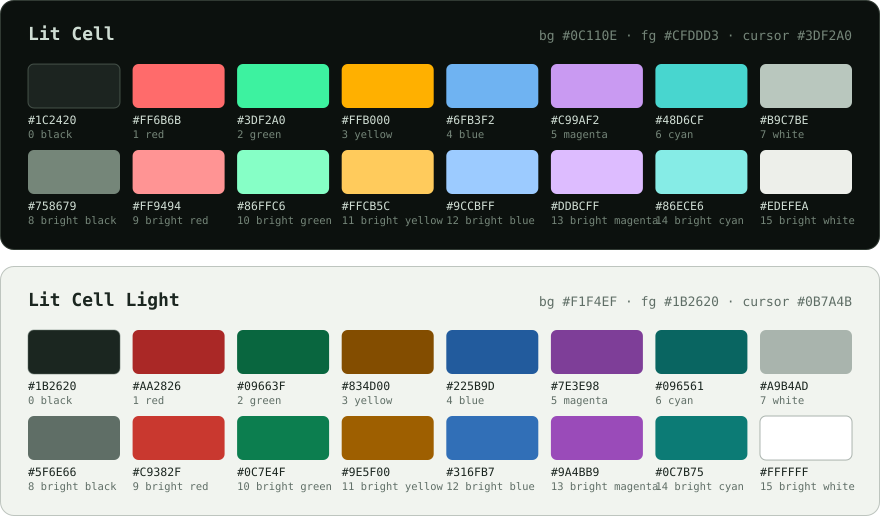

# Lit Cell

A pair of terminal color schemes, dark and light, from [Zinc](https://zincterminal.dev), a precise, native terminal for Windows.

Lit Cell is built around a phosphor screen: a near-black ground with a faint green cast, a mint phosphor green, warm amber and soft, readable pastels. Lit Cell Light keeps the same hues, deepened for a pale paper ground.

## Install

Each folder holds both schemes, `lit-cell` and `lit-cell-light`.

| Terminal | How |
|---|---|
| **Zinc** | Built in. Choose it under Settings > Colors. |
| **Ghostty** | Built in as `Lit Cell` once your Ghostty release includes it. Until then, copy `ghostty/lit-cell` to `~/.config/ghostty/themes/` and set `theme = lit-cell`. |
| **Windows Terminal** | Paste the contents of `windows-terminal/lit-cell.json` into the `schemes` list in `settings.json`, then set `"colorScheme": "Lit Cell"` on a profile. |
| **Alacritty** | Copy `alacritty/lit-cell.toml` somewhere, then add its path to `import` under `[general]` in `alacritty.toml`. |
| **kitty** | Copy `kitty/lit-cell.conf` next to `kitty.conf` and add `include lit-cell.conf`. |
| **WezTerm** | Copy `wezterm/lit-cell.toml` to `~/.config/wezterm/colors/` and set `config.color_scheme = "lit-cell"`. |
| **iTerm2** | Settings > Profiles > Colors > Color Presets > Import, then pick `iterm2/lit-cell.itermcolors`. |
| **foot** | Add `include=/path/to/foot/lit-cell.ini` under `[main]` in `foot.ini`. |
| **Konsole** | Copy `konsole/lit-cell.colorscheme` to `~/.local/share/konsole/`, then choose Lit Cell in the profile's appearance settings. |
| **VS Code** (integrated terminal) | Merge `vscode/lit-cell.json` into your user `settings.json`. |

Over 30 more formats, including PuTTY, Termux, Rio and Tilda, are generated by [iTerm2-Color-Schemes](https://github.com/mbadolato/iTerm2-Color-Schemes).

## Ports

Want Lit Cell in your editor, pager or another app? [SPEC.md](SPEC.md) defines what each color is for, including syntax highlighting, diffs and Markdown, so a port can match the rest without guessing.

Made a port? Open an issue with a link and it will be listed here.

## Palette

<!-- generated:palette -->
|  | Lit Cell | Lit Cell Light |
|---|---|---|
| Background | `#0C110E` | `#F1F4EF` |
| Foreground | `#CFDDD3` | `#1B2620` |
| Cursor | `#3DF2A0` | `#0B7A4B` |
| Selection | `#1E4533` | `#CBE6D6` |
| Black / bright | `#1C2420` / `#758679` | `#1B2620` / `#5F6E66` |
| Red / bright | `#FF6B6B` / `#FF9494` | `#AA2826` / `#C9382F` |
| Green / bright | `#3DF2A0` / `#86FFC6` | `#09663F` / `#0C7E4F` |
| Yellow / bright | `#FFB000` / `#FFCB5C` | `#834D00` / `#9E5F00` |
| Blue / bright | `#6FB3F2` / `#9CCBFF` | `#225B9D` / `#316FB7` |
| Magenta / bright | `#C99AF2` / `#DDBCFF` | `#7E3E98` / `#9A4BB9` |
| Cyan / bright | `#48D6CF` / `#86ECE6` | `#096561` / `#0C7B75` |
| White / bright | `#B9C7BE` / `#EDEFEA` | `#A9B4AD` / `#FFFFFF` |
<!-- /generated -->

Every text color reaches at least 4.5:1 against the background, and the build checks it. In Lit Cell Light, the whites stay quiet on purpose, since programs use them as backgrounds. [SPEC.md](SPEC.md#contrast) has every ratio.

## Sources

Lit Cell is defined once, in [`tokens/`](tokens/), as [W3C design tokens](https://www.designtokens.org/tr/drafts/format/). There's one file per variant, plus `roles.tokens.json` for what each color is for. Everything else is generated from them:

- `python tools/build.py` writes `src/*.yml` (the format iTerm2-Color-Schemes uses), the tables in [SPEC.md](SPEC.md) and this README, and `palette.svg`. It also checks contrast, and fails if a text color stops being readable.
- `tools/ports.sh` writes every terminal port from `src/*.yml` with iTerm2-Color-Schemes' own generator, so these ports match the ones that project publishes.

CI runs both and fails if anything is out of date. To change a color, edit `tokens/` and run both.

## License

[MIT](LICENSE). Use, modify and redistribute the schemes freely.
